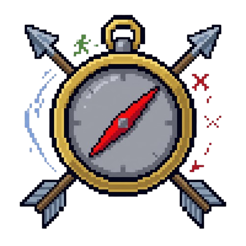

<div align="center">



# Hunter's Compass Plus

**The definitive, robust Manhunt tracking mod for Minecraft 26.3 on Fabric.**

[](https://www.minecraft.net/)
[](https://fabricmc.net/)
[](https://adoptium.net/)
[](LICENSE)

</div>

----

## 🧭 Overview

**Hunter's Compass Plus** is an ultra-reliable, dimension-aware tracking compass mod built for high-stakes Minecraft Manhunt matches. It eliminates common tracking compass loopholes (accidental drops, container stashing, death loss, cross-dimension desyncs) through low-level engine integration and data components.

Whether you're playing 1v1 or 1vMany, Hunter's Compass Plus provides seamless real-time tracking with zero lag and airtight compass management.

---

## ✨ Features

- 🎯 **Continuous Real-Time Tracking**: Automatically updates the compass targeting using Minecraft's modern `LODESTONE_TRACKER` data components with zero reliance on physical lodestone blocks.
- 🌌 **Cross-Dimension Portal Memory**:
  - **Same Dimension**: Hunter's compass points directly to the runner's live coordinates in real-time.
  - **Overworld ↔ Nether**: When the runner transitions between dimensions, the mod remembers the exact coordinates of the portal they entered and points the hunter directly there until the hunter transitions to the same dimension.
  - **The End**: When the runner jumps into the End portal, the hunter's compass locks onto the End Portal frame coordinates in the Overworld.
- 🔒 **Tamper-Proof Hotbar Locking**:
  - The tracking compass is forcefully locked into **Hotbar Slot 0** (1st hotbar slot) as soon as manhunt starts.
  - **Drop Proof**: Intercepts and blocks dropping via `Q`, dragging out of inventory screens, or death drops.
  - **Container Exploit Proof**: Prevents hunters from storing the compass inside chests, barrels, hoppers, crafting tables, or ender chests via injection into slot validation.
  - **Respawn Persistence**: Returns instantly to hotbar slot 0 upon player death and respawn using `ServerPlayerEvents.COPY_FROM`.
- ⚡ **Full Brigadier Command Support**:
  - Registered under `/tracker` and its short alias `/t`.
  - Rich tab completion and argument suggestions for all subcommands.

---

## 🎮 Command Guide

Both `/tracker` and `/t` can be used interchangeably:

| Command | Alias | Description |
|---|---|---|
| `/tracker sethunter <player>` | `/t sethunter <player>` | Assigns a player as a hunter. Supports multiple hunters. |
| `/tracker setrunner <player>` | `/t setrunner <player>` | Assigns the target runner and resets dimension portal logs. |
| `/tracker start` | `/t start` | Begins tracking, locks compasses into slot 0, and starts the tracking loop. |
| `/tracker stop` | `/t stop` | Stops the tracking loop, clears roles, and purges all tracking compasses. |

---

## 🌐 Dimension Tracking Logic

```
   [ Runner & Hunter in Same Dimension ]
                    │
                    ▼
     Points to Runner's Live Coordinates

──────────────────────────────────────────────────────────

   [ Runner Steps into Nether/Overworld Portal ]
                    │
                    ▼
     Compass locks onto Entered Portal Coordinates
     (Remains until hunter enters that dimension)

──────────────────────────────────────────────────────────

   [ Runner Enters the End Dimension ]
                    │
                    ▼
     Compass locks onto Stronghold End Portal Coordinates
```

---

## 📥 Installation

### Requirements
- **Minecraft**: `26.3`
- **Fabric Loader**: `>=0.19.5`
- **Fabric API**: `0.161.0+26.3` or newer (built against `0.165.0+26.3`)
- **Java**: `Java 25` runtime

### How to Install
1. Ensure you have the **Fabric Loader** installed for Minecraft 26.3.
2. Download the latest `manhunt-tracker-1.0.0.jar` from the [Releases](https://github.com/ImSnigdho/Hunter-s-Compass-Plus---A-Minecraft-Mod/releases) page.
3. Place `manhunt-tracker-1.0.0.jar` along with `fabric-api` into your `.minecraft/mods` folder.
4. Launch the game and start hunting!

> [!NOTE]
> This mod functions seamlessly on both singleplayer worlds (open to LAN) and dedicated Fabric multiplayer servers.

---

## 🛠️ Building From Source

If you want to compile the project locally:

```bash
# Clone the repository
git clone https://github.com/ImSnigdho/Hunter-s-Compass-Plus---A-Minecraft-Mod.git
cd Hunter-s-Compass-Plus---A-Minecraft-Mod

# Build using Gradle (requires JDK 25)
$env:JAVA_HOME="C:\Path\To\JDK-25" # Windows PowerShell
./gradlew build
```

The compiled binary will be generated in `build/libs/manhunt-tracker-1.0.0.jar`.

---

## 📄 License & Rights

**Copyright © 2026 Nowrid Ifrad Snigdho. All Rights Reserved.**

This software and its source code are proprietary. 
- You **may not** redistribute, modify, re-upload, sell, or claim ownership of this software or any part of its source code.
- Customizations, repackaging, or claims of authorship without explicit written authorization from Nowrid Ifrad Snigdho are strictly forbidden.
- See the full [LICENSE](LICENSE) for detailed legal terms.

---

<div align="center">
Developed with ❤️ by <b>Nowrid Ifrad Snigdho</b>
</div>
